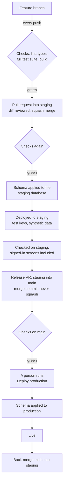

# Release process

How a change gets from an idea to a hire firm's screen, and what stops a bad change on the way.

## The flow

## The controls, and why each exists

| Control | Why |
| --- | --- |
| Feature branches deploy nowhere | A branch preview needed a credential that could also deploy production. Removing previews removed the risk; changes are looked at on staging instead. |
| The same checks run on every push | A test that only runs sometimes is a test someone will skip. |
| Hosting auto-deploy is switched off | The only way to production is the pipeline, so there is no second door to forget about. |
| Staging uses test identity and payment keys, synthetic data and is hidden from search | Nothing a firm or hirer owns is ever used to try a change. |
| Release is a merge commit, not a squash | Staging and `main` keep a shared history, so the next release does not re-ship old work or conflict. |
| A person runs the production deploy | Merging verifies; deploying is a separate, deliberate decision. Automated sessions are blocked from starting it. |
| The deploy refuses a commit whose checks did not pass | A green merge on a different commit is not evidence for this one. |
| Back-merge after every release | Staging stays a superset of production. |
| One merge queue for staging | Only the session holding the queue claim merges into staging, after the full suite. Two writers never race the same branch. |

## A release is all or nothing

A release carries everything on staging. In August 2026 a release was held for review while some unfinished design work sat on staging. The question became "ship only what's confirmed good", which isn't possible: the release is one merge.

The deciding fact wasn't the design work. The weekly encrypted backup job lived only on staging, and scheduled jobs run only from the default branch, so **the backup had never once run** and couldn't until the release landed. We shipped the whole release knowingly, with the unfinished work listed.

What changed: anything scheduled is now checked against the branch it actually runs from, and "is it on main?" is part of calling an operational job done.

## What I'd point to in an interview

This is change control, built and enforced rather than read about: a gated path, a separation between verify and deploy, a named person on the final step, and a record of why each rule exists.
